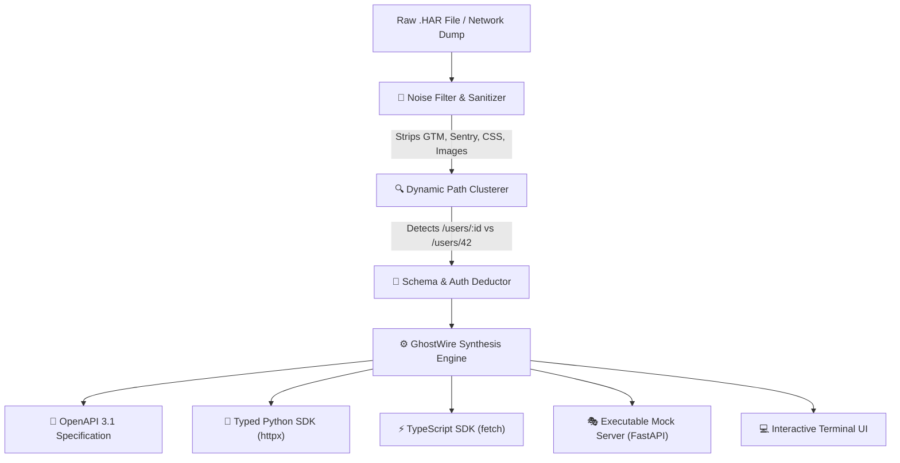

# 👻 GhostWire

<p align="center">
  <b>The Autonomous Reverse-Engineering Agent for Hidden APIs & Web Traffic.</b><br>
  <i>Feed it any <code>.har</code> network capture or website traffic. It scrubs the noise, deduces schemas & authentication, and synthesizes production-ready Python/TypeScript SDKs, OpenAPI 3.1 specs, and local mock servers in 5 seconds.</i>
</p>

<p align="center">
  <a href="https://github.com/your-username/ghostwire/blob/main/LICENSE"></a>
  <a href="https://pypi.org/project/ghostwire/"></a>
  <a href="https://github.com/your-username/ghostwire/stargazers"></a>
  <a href="https://github.com/your-username/ghostwire/issues"></a>
  <a href="https://github.com/your-username/ghostwire"></a>
</p>

---

## ⚡ The Problem

Every developer, security researcher, scraper, and bot creator reverse-engineers private APIs and web traffic. Right now, this requires **hours of manual work**:
1. Opening DevTools (`F12`) while 600 messy network requests flood the screen.
2. Digging through tracking pixels, analytics, and static assets to find real data endpoints.
3. Guessing authentication tokens, CSRF headers, and payload structures.
4. Manually writing boilerplate `requests` or `fetch` code line-by-line.

**GhostWire automates that entire workflow in 5 seconds.**

```
DevTools "Save as HAR"  ──►  GhostWire  ──►  • OpenAPI 3.1 Spec (JSON/YAML)
                                             • Typed Python SDK (client.py)
                                             • TypeScript SDK (client.ts)
                                             • Instant Mock API (FastAPI)
```

---

## 🎬 Terminal Preview

```text
   ______  __                 __  _       ___          
  / ____/ / /_  ____   _____ / /_| |     / (_)_____ ___ 
 / / __  / __ \/ __ \ / ___// __/| | /| / / // ___// _ \
/ /_/ / / / / / /_/ /(__  )/ /_  | |/ |/ / // /   /  __/
\____/ /_/ /_/\____//____/ \__/   |__/|__//_//_/    \___/ 

⚡ Autonomous Reverse-Engineering Agent for Hidden APIs & Web Traffic
v0.1.0 | 100% Offline & Free

╭──────────────────────── 📊 Traffic Analysis Summary ─────────────────────────╮
│ Total Captured Entries:            784                                       │
│ Scrubbed Noise (Trackers/Assets):  742 (Google Analytics, Sentry, CSS, PNG)  │
│ Discovered API Endpoints:          8 Clean Endpoints                         │
│ Detected Authentication:           BEARER (Token: eyJh...8912)               │
╰──────────────────────────────────────────────────────────────────────────────╯

                      🎯 Discovered Endpoints & Parameters                      
┏━━━━━━━━━━┳━━━━━━━━━━━━━━━━━━━━━━━━━━━━━━━━┳━━━━━━━━━━━━━━━━━━┳━━━━━━━━━━━━━┓
┃ Method   ┃ Path                           ┃ Parameters       ┃ Responses   ┃
┡━━━━━━━━━━╇━━━━━━━━━━━━━━━━━━━━━━━━━━━━━━━━╇━━━━━━━━━━━━━━━━━━╇━━━━━━━━━━━━━┩
│ GET      │ /api/v1/user/me                │ None             │ 200         │
│ GET      │ /api/v1/workspaces             │ limit, page      │ 200         │
│ POST     │ /api/v1/workspaces/{id}/invite │ id (path)        │ 201         │
│ DELETE   │ /api/v1/projects/{projectId}   │ projectId (path) │ 204         │
└──────────┴────────────────────────────────┴──────────────────┴─────────────┘

📦 Generated Code & Artifacts:
  ✔ openapi.json & openapi.yaml   (OpenAPI 3.1.0 Specification)
  ✔ client.py                     (Production Python SDK via httpx)
  ✔ client.ts                     (Zero-dependency TypeScript SDK)
  ✔ mock_server.py                (Standalone FastAPI Mock Server)
```

---

## 🚀 Key Features

* **🧹 Automated Telemetry & Noise Scrubbing:** Filters out 30+ analytics and tracking networks (Google Analytics, Datadog, Sentry, Hotjar, Facebook Pixel, Intercom) as well as fonts, images, and CSS.
* **🔍 Dynamic Path Clustering:** Automatically converts dynamic IDs, UUIDs, and hashes (e.g. `/users/102`, `/users/459`) into parameterized endpoint templates (`/users/{userId}`).
* **🔑 Zero-Config Auth Detection:** Scans request headers and cookies to isolate Bearer JWTs, API keys, session cookies, and basic auth headers.
* **🐍 Typed Python SDK:** Emits idiomatic `httpx` code with typed methods, auto-auth injection, query params, and docstrings.
* **⚡ Native TypeScript SDK:** Emits clean TypeScript code using native `fetch` with zero external dependencies.
* **🎭 1-Click Mock Server:** Generates an executable FastAPI server populated with the actual captured response fixtures, letting you develop and test offline.
* **🛡️ 100% Local & Privacy-Preserving:** Runs completely on your machine. Zero data leaves your computer. No mandatory OpenAI or external API keys needed.

---

## 📦 Installation

Install GhostWire directly via `pip`:

```bash
pip install ghostwire
```

Or install from source:

```bash
git clone https://github.com/your-username/ghostwire.git
cd ghostwire
pip install -e .
```

---

## ⚡ 30-Second Quickstart

### 1. Export Network Traffic
In Chrome, Firefox, or Safari:
1. Open Developer Tools (`F12` or `Cmd+Option+I`) ➔ Go to the **Network** tab.
2. Browse the web app or perform the actions you want to reverse-engineer.
3. Right click in the network list ➔ **"Save all as HAR with content"** (saved as `traffic.har`).

### 2. Inspect the Traffic
View the scrubbed endpoints and detected auth immediately:

```bash
ghostwire inspect traffic.har
# Or use the shortcut:
gw inspect traffic.har
```

### 3. Generate Everything
Generate OpenAPI specs, Python/TS SDKs, and the mock server:

```bash
ghostwire analyze traffic.har --generate-all --output-dir ./my_api
```

### 4. Run the Local Mock Server
Start an instant mock API replica of the target app on `localhost:8000`:

```bash
python my_api/mock_server.py
```
*Open [http://localhost:8000/docs](http://localhost:8000/docs) in your browser for the live Swagger UI!*

---

## 🧠 Architecture



---

## 📊 Comparison: Why GhostWire?

| Feature | DevTools Manual | Postman Interceptor | `morluto/rea` | **GhostWire** |
| :--- | :---: | :---: | :---: | :---: |
| **Noise & Tracker Filtering** | ❌ None | ❌ Manual | ❌ N/A | ✅ **Automatic** |
| **Dynamic Path Clustering** (`/users/{id}`) | ❌ Manual | ❌ Manual | ❌ N/A | ✅ **Automated regex & AST** |
| **Auth Extraction** (Bearer/Cookies) | ❌ Manual copy | ⚠️ Partial | ❌ N/A | ✅ **Automated & Masked** |
| **Static Binary Analysis** (Ghidra/Electron) | ❌ No | ❌ No | ✅ Yes | ⏳ *Coming in v0.2* |
| **OpenAPI 3.1 Spec Generator** | ❌ Manual write | ⚠️ Import only | ❌ No | ✅ **1-Click Generation** |
| **Typed Python SDK (`client.py`)** | ❌ Hours of work | ❌ Basic curl | ❌ No | ✅ **Production Ready** |
| **Typed TypeScript SDK (`client.ts`)**| ❌ Hours of work | ❌ No | ❌ No | ✅ **Zero-dependency fetch** |
| **Instant Local Mock Server** | ❌ No | ⚠️ Paid Cloud | ❌ No | ✅ **FastAPI Executable** |
| **100% Offline & Free** | ✅ Yes | ❌ Freemium | ✅ Yes | ✅ **100% Free (MIT)** |

---

## 🗺️ Roadmap

- [x] High-performance HAR network parser
- [x] Intelligent tracker & asset scrubbing engine
- [x] Parameterized URL clustering (UUID, Integer, Mongo ObjectID)
- [x] Deep JSON schema inference & observation merging
- [x] Automated OpenAPI 3.1 JSON/YAML export
- [x] Production Python SDK generator (`httpx`)
- [x] Zero-dependency TypeScript SDK generator (`fetch`)
- [x] Standalone FastAPI Mock Server generator
- [ ] Direct Chrome DevTools Protocol (CDP) live proxy listener (`ghostwire listen`)
- [ ] WebSocket and GraphQL stream decompiler
- [ ] Local Ollama / LLM semantic docstring enricher

---

## 🤝 Contributing

Contributions, issues, and feature requests are welcome!  
Feel free to check out the [issues page](https://github.com/your-username/ghostwire/issues).

1. Fork the Project
2. Create your Feature Branch (`git checkout -b feat/amazing-feature`)
3. Commit your Changes (`git commit -m 'feat: add amazing feature'`)
4. Push to the Branch (`git push origin feat/amazing-feature`)
5. Open a Pull Request

---

## 📄 License

Distributed under the **MIT License**. See `LICENSE` for more information.
