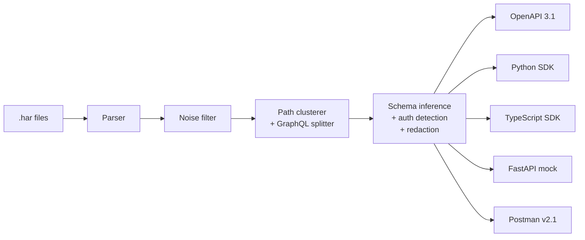

# 👻 GhostWire

<p align="center">
  <b>Turn browser traffic into an API you can actually use.</b><br>
  <i>Record a <code>.har</code> file in DevTools. GhostWire strips the trackers, figures out the endpoints, parameters, schemas and auth, and generates an OpenAPI 3.1 spec, typed Python & TypeScript SDKs, a runnable mock server and a Postman collection.</i>
</p>

<p align="center">
  <a href="https://github.com/Himanshu-Sharma12/ghostwire/actions/workflows/ci.yml"></a>
  <a href="https://pypi.org/project/ghostwire-cli/"></a>
  <a href="https://github.com/Himanshu-Sharma12/ghostwire/blob/main/LICENSE"></a>
  
  
</p>

---

## Why

You open DevTools on a web app, and 600 requests scroll past: analytics pixels, fonts, Sentry beacons, and somewhere in there the twelve calls that actually matter. Turning those into something reusable means copying headers by hand, guessing which path segments are IDs, and writing a client from scratch.

GhostWire does that part for you:

```
DevTools "Save all as HAR"  ──►  gw analyze traffic.har  ──►  openapi.json / openapi.yaml
                                                             client.py        (httpx)
                                                             client.ts        (fetch, zero deps)
                                                             mock_server.py   (FastAPI)
                                                             postman_collection.json
```

Everything runs locally. No LLM, no API key, no traffic leaves your machine (except `gw call`, which replays a request on purpose).

## Demo

```text
$ gw inspect traffic.har

╭─────────────────────────────────────────── 📊 Traffic Analysis Summary ────────────────────────────────────────────╮
│ Total Captured Entries:            12                                                                              │
│ Scrubbed Noise (Trackers/Assets):  2                                                                               │
│ Discovered API Endpoints:          9                                                                               │
│ Detected Authentication:           COOKIE (Token: s3cr...-123)                                                     │
╰────────────────────────────────────────────────────────────────────────────────────────────────────────────────────╯
                                         🎯 Discovered Endpoints & Parameters                                         
┏━━━━━━━━━━┳━━━━━━━━━━━━━━━━━┳━━━━━━━━━━━━━━━━━━━━━━━━┳━━━━━━━━━━━━━━━━━━━━━━━━┳━━━━━━━━━━━━━━━━━━━━━━━━━┳━━━━━━━━━━━┓
┃ Method   ┃ Host            ┃ Path                   ┃ Operation ID           ┃ Parameters              ┃ Responses ┃
┡━━━━━━━━━━╇━━━━━━━━━━━━━━━━━╇━━━━━━━━━━━━━━━━━━━━━━━━╇━━━━━━━━━━━━━━━━━━━━━━━━╇━━━━━━━━━━━━━━━━━━━━━━━━━╇━━━━━━━━━━━┩
│ POST     │ app.example.dev │ /api/auth/login        │ create_auth_login      │ None                    │ 200       │
│ DELETE   │ app.example.dev │ /api/projects/{projec… │ delete_projects_by_pr… │ projectId (path),       │ 204       │
│          │                 │                        │                        │ memberId (path)         │           │
│ GET      │ app.example.dev │ /api/search            │ get_search             │ filter[status] (query), │ 200       │
│          │                 │                        │                        │ from (query), page.size │           │
│          │                 │                        │                        │ (query), self (query)   │           │
│ GET      │ app.example.dev │ /api/user_profile      │ get_user_profile       │ None                    │ 200       │
│ GET      │ app.example.dev │ /api/users/me          │ get_users_me           │ None                    │ 200       │
│ GET      │ app.example.dev │ /api/users/{userId}    │ get_users_by_userId    │ userId (path)           │ 200       │
│ POST     │ app.example.dev │ /graphql (GetViewer)   │ graphql_GetViewer      │ None                    │ 200       │
│ POST     │ app.example.dev │ /graphql (ListTeams)   │ graphql_ListTeams      │ None                    │ 200       │
│ POST     │ app.example.dev │ /graphql               │ graphql_RenameProject  │ None                    │ 200       │
│          │                 │ (RenameProject)        │                        │                         │           │
└──────────┴─────────────────┴────────────────────────┴────────────────────────┴─────────────────────────┴───────────┘
```

*(Real output for [`tests/fixtures/edge_cases.har`](tests/fixtures/edge_cases.har); try it yourself.)*

## Install

```bash
pip install ghostwire-cli
```

Or for development:

```bash
git clone https://github.com/Himanshu-Sharma12/ghostwire.git
cd ghostwire
pip install -e ".[dev]"
```

This installs two equivalent commands: `ghostwire` and the short alias `gw`.

## Quickstart

**1. Record traffic.** In Chrome, Firefox or Safari open DevTools → **Network**, use the app, then right-click the request list → **Save all as HAR with content**.

**2. See what's in it.**

```bash
gw inspect traffic.har
gw inspect traffic.har --domain api.example.com   # ignore other hosts
gw inspect login.har browse.har checkout.har      # merge several captures
```

**3. Generate everything.**

```bash
gw analyze traffic.har -o ./my_api
```

**4. Use the generated SDK.**

```python
# Credentials come from the auth_token argument or an environment variable (e.g. API_TOKEN)
from client import ApiClient

with ApiClient(auth_token="...") as api:
    me = api.get_users_me()
    user = api.get_users_by_userId(userId=42)
    hits = api.get_search(filter_status="open", page_size=20)   # sent as filter[status], page.size
    api.graphql_RenameProject(variables={"id": "p_9", "name": "New name"})
```

```ts
import { ApiClient } from "./client";

const api = new ApiClient({ authToken: process.env.API_TOKEN });
const user = await api.getUsersByUserId(42);
```

**5. Run a mock of the API offline.**

```bash
gw mock traffic.har --port 8000          # or: python my_api/mock_server.py --port 8000
open http://localhost:8000/docs
```

**6. Replay a single request.**

```bash
gw curl traffic.har get_users_me      # print a copy-pasteable curl command
gw call traffic.har get_users_me      # send it and pretty-print the response
```

`gw call` asks for confirmation before sending anything other than a GET; pass `--yes` to skip.

## What it figures out

| Problem | What GhostWire does |
| :--- | :--- |
| **Noise** | Drops 70 analytics, ads, marketing and consent hosts (Google Analytics/Ads, Sentry, Datadog, HubSpot, Hotjar, Segment, …), telemetry paths on any host (`/collect`, `/log_event`, `/pixel`, `/beacon`, `/api/sentry` tunnels), static assets and CORS preflights. `--domain` overrides the lists when the "tracker" is your target. |
| **Dynamic paths** | Turns `/users/42`, `/files/<uuid>`, `/orders/<mongo-id>`, `/customers/cus_9s6XKz` into `/users/{userId}`, etc., naming parameters after their collection (`addresses` → `addressId`). Snake-case words such as `/api/user_profile` stay literal. |
| **GraphQL** | Recognises GraphQL by URL or by request shape (e.g. `/api/streamGraphql`), including **batched** requests (Apollo batch link), and splits them into one endpoint per operation. SDKs get a method per operation that takes `variables` (and speak the batch format when the site does); the mock server dispatches by operation and answers batches. |
| **Schemas** | Infers JSON Schema from every observation and merges them: optional fields, nullable fields (`["string", "null"]`), integer→number widening, and array items merged across elements. |
| **Auth** | Detects Bearer/JWT, Basic, API-key headers and session cookies, picking the scheme used most and its most recent token. |
| **Awkward names** | Query parameters such as `filter[status]`, `page.size` or `from` become valid identifiers (`filter_status`, `page_size`, `from_`) while the original name is still sent on the wire. |

## 🔒 Secrets & sharing

HAR files contain live credentials. By default GhostWire keeps them out of everything it writes to disk:

- Generated SDKs **do not** embed the captured token. They read it from the `auth_token` argument or an environment variable (`API_TOKEN`, `API_KEY`, `API_SESSION`, …), and the Postman collection uses an empty `{{authToken}}` variable.
- Passwords, tokens, API keys, secrets and JWT-looking strings inside request/response bodies are replaced with `<redacted>` in the OpenAPI examples, mock fixtures and Postman bodies.
- The mock server binds to `127.0.0.1` unless you pass `--host 0.0.0.0`.

If the output is only for you, `gw analyze traffic.har --embed-secrets` keeps the captured values.

`gw curl` and `gw call` **do** use the real captured credentials, since replaying the request is their whole job. Treat their output like the HAR file itself.

Only analyze traffic from accounts and systems you are authorized to test.

## How it works



| Module | Responsibility |
| :--- | :--- |
| [`core/parser.py`](ghostwire/core/parser.py) | HAR → `CapturedTransaction` (JSON, form and base64 bodies) |
| [`core/filter.py`](ghostwire/core/filter.py) | Tracker, asset and preflight filtering |
| [`core/cluster.py`](ghostwire/core/cluster.py) | Path parameterization and GraphQL operation detection |
| [`core/schema.py`](ghostwire/core/schema.py) | JSON Schema inference and merging |
| [`core/auth.py`](ghostwire/core/auth.py) | Credential detection and masking |
| [`core/redact.py`](ghostwire/core/redact.py) | Secret redaction in payloads |
| [`core/analyzer.py`](ghostwire/core/analyzer.py) | Orchestrates the pipeline into `EndpointModel`s |
| [`generators/`](ghostwire/generators) | One module per output format |

Every generated artifact is checked in CI: the Python SDK is imported and exercised, the TypeScript SDK passes `tsc --strict`, the OpenAPI document passes `openapi-spec-validator`, and the mock server is driven through FastAPI's test client. A separate job records real traffic from [dummyjson.com](https://dummyjson.com), generates an SDK from it and calls the live API.

## Limitations

GhostWire only knows what was in the capture. Endpoints you never triggered, fields that were always null, and error responses you never hit will be missing or loosely typed. If a capture spans several hosts, the SDKs default to the first host's base URL (pass `--domain` to focus on one). Path parameter detection is heuristic; check `gw inspect` before you rely on the output.

## Roadmap

- [ ] `gw listen`: capture live from Chrome via the DevTools Protocol, no HAR export needed
- [ ] Per-host SDKs for captures that span several APIs
- [ ] Typed request/response models in the SDKs (TypedDict / TS interfaces) from the inferred schemas
- [ ] WebSocket and GraphQL subscription capture
- [ ] Optional local-LLM pass for nicer method names and docstrings

## Contributing

Bug reports with a (sanitized!) HAR snippet that reproduces the problem are the most useful thing you can send. See [CONTRIBUTING.md](CONTRIBUTING.md).

## License

[MIT](LICENSE)
